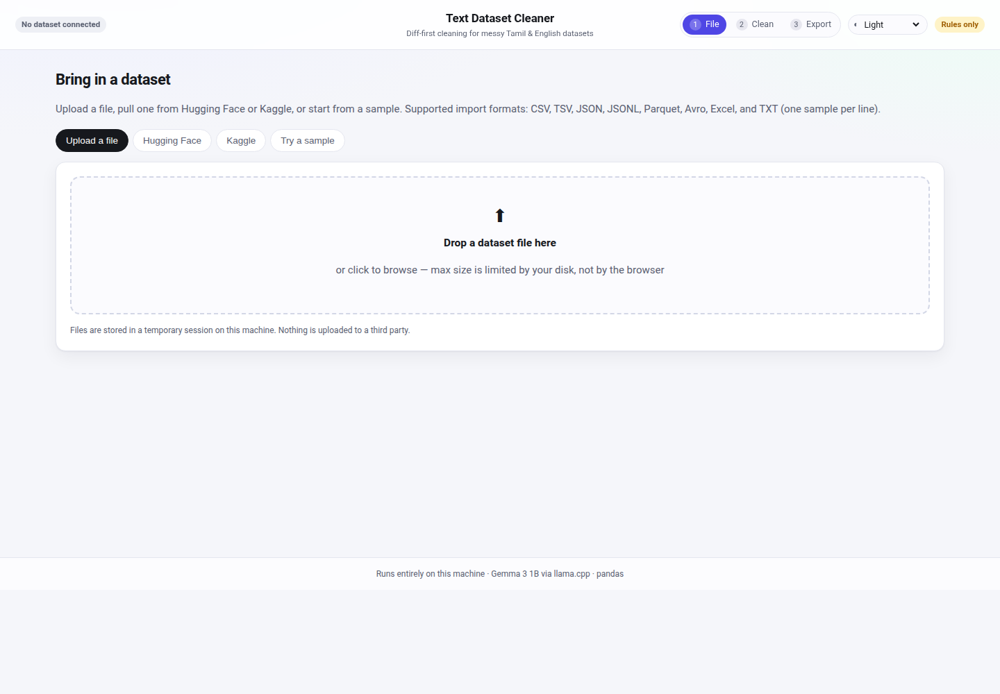
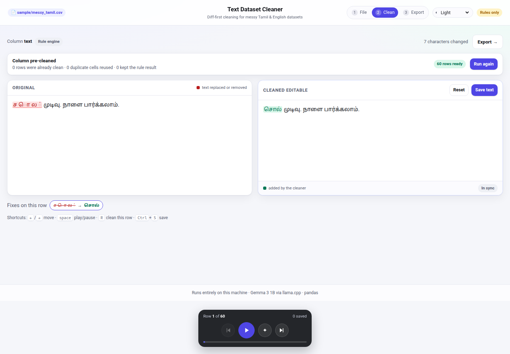
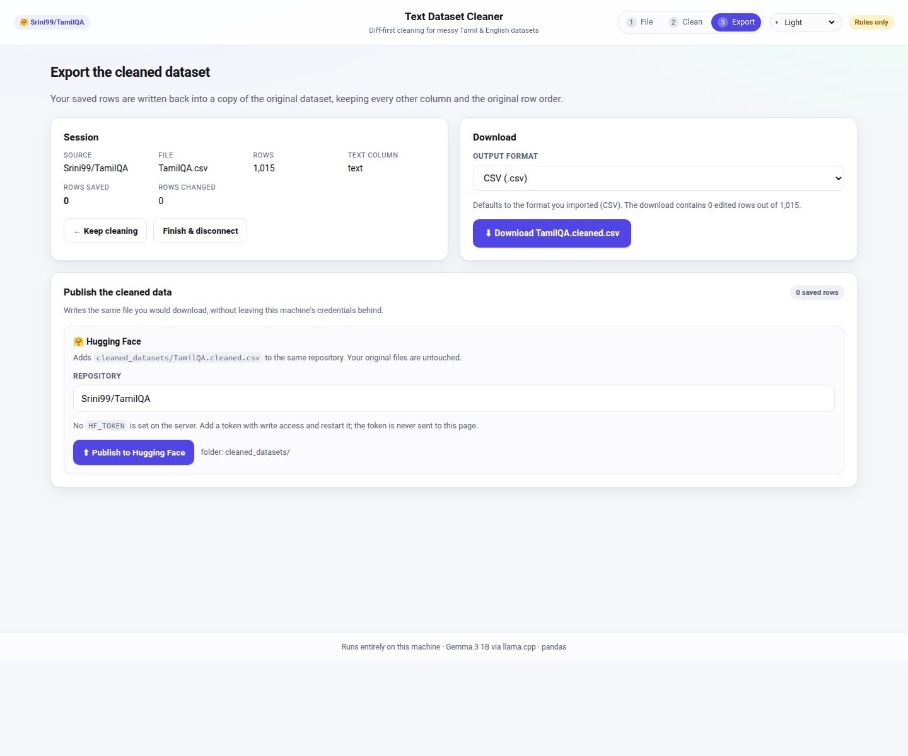
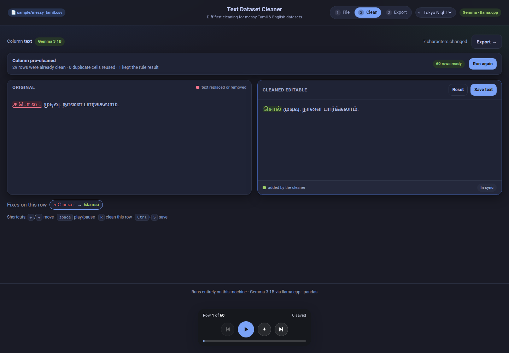

# Text Dataset Cleaner

Diff-first cleaning for messy text datasets. Load a CSV/TSV/JSON/JSONL/Parquet/Avro/Excel
file or a line-oriented `.txt` file (locally or from Hugging Face / Kaggle), pick the text
column, and clean it one row at a time with a **local Gemma 3 1B** model running through
**llama.cpp** — while every change is shown as a red/green diff you can edit before saving.

Built for the *Hacktoberfest Open-Source AI Challenge: Week 3 — Slow and Steady*
(it automates a task people dread: hand-repairing broken Tamil/English text).

## Why it exists

Real dataset columns are full of boundary damage:

| Wrong | Right | Kind |
| --- | --- | --- |
| `download the dataset` | `downloaded the dataset` | stray spaces inside a word |
| `homescreenwallpaper` | `home screen wallpaper` | two words glued together |
| `d o w n l o a d e d` | `downloaded` | letters split by spaces |
| `வ ண க் க ம்` | `வணக்கம்` | Tamil grapheme splits |
| `text .` / `a\u00a0b` / `\u200btext` | `text.` / `a b` / `text` | punctuation, NBSP, zero-width |

Regex alone cannot decide *join vs split*: that is a word-boundary decision, so the app
solves it with a **dataset-adaptive lexicon + dynamic program**, and only then asks a small
language model for spelling polish.

## How it works

```
Browser (React + Vite)
  /file-select    upload · Hugging Face · Kaggle · samples
  /clean-data     diff editor · playback controls · save into the output frame
  /upload         export in any pandas-supported format · publish back to HF/Kaggle
        │  same-origin /api (Vite proxy in dev, FastAPI static mount in prod)
        ▼
FastAPI (Python)
  sources.py    HF Hub + Kaggle search/list/download, upload/publish, friendly errors
  jobs.py       background download jobs with byte progress (browser polls)
  dataio.py     pandas readers/writers (csv, tsv, json, jsonl, parquet, avro, xlsx, txt, zip)
  cleaner.py    unicode hygiene + BoundaryModel (lexicon, char n-gram, DP)
  llm.py        llama.cpp / Ollama OpenAI-compatible client + JSON repair + validation
  batch.py      one-pass whole-column cleaning: skip, de-duplicate, model pool
  store.py      sessions: original frame, suggestions, edits, on-disk mirror
```

### The boundary model (`backend/cleaner.py`)

1. **Hygiene** — NFC, zero-width removal, control chars, NBSP, space-before-punctuation.
2. **Dataset lexicon** — token frequencies from the chosen column. A token is *blocked*
   (forbidden from being re-split) only with real evidence: both halves must appear as their
   own words in the column **and** at least twice as often as the glued form. A Latin word
   the bundled dictionary knows is never treated as a glue error, so `downloaded` and
   `stopwatch` stay whole even when `down`, `loaded`, `stop` and `watch` also occur; corrupt
   `downloadthe` still fails to become a word.
3. **Dynamic program** over token boundaries: keep, merge 2–6 fragments, or split 1 token
   into 2–3 known words. Costs come from unigram frequencies (with an English word list for
   split candidates and a character trigram model for unknowns). For a non-Latin script a
   split is only trusted when the column itself writes the two parts side by side somewhere
   else: Tamil is agglutinative, so `பெண்களின்` is *legitimately* `பெண்` + `களின்`, and "both
   halves are known words" is normal morphology rather than evidence of a glue error. Without
   that rule a thin column split correct inflected words.
4. **Model escalation (spelling only)** — Gemma 3 1B receives the *already rule-cleaned*
   text and returns `{"cleaned": "..."}` JSON. Word boundaries are the rule engine's job, so
   the answer is replayed over the rule-cleaned text one edit at a time (`freeze_boundaries`):
   an edit that changes letters inside a word is kept, but adding, removing or moving a space
   is **reverted** — except a space removal whose fused word the lexicon or dictionary knows,
   which lets `down loaded` reach `downloaded`. Deleting or inventing a whole word is
   reverted too, as is an escape sequence the model types into the text (`15\nகிராமம்`). The
   answer budget is now measured by the model itself — its own tokenizer against the server's
   context window — instead of guessed from the character count, so a long cell no longer
   fails just because the reply ran out of room, and a cell that genuinely cannot fit is
   reported instead of returning nothing. A 1B model can
   still decline to restate a very long cell; that answer is rejected with the reason shown
   and the rule result is kept. The parser is
   tolerant of how a 1B model actually writes Tamil JSON: it reads a value closed with a curly
   quote (`…னர்.”}"`) and one the model never closed at all. If the model is offline or the
   answer is malformed, the rule result is used and the UI says so.

### Cleaning a whole column in one pass

Running the model per row while you click through a 500-row file is roughly an hour of
waiting, so `/clean-data` has a **Clean all N rows** button that pays that cost once:

```
rules pass on every row (ms)  →  skip rows already clean  →  de-duplicate identical cells
        →  Gemma on the rest, 3 calls in flight (llama.cpp slots)
        →  every result cached on the session, so each row opens instantly
```

The row view afterwards needs no waiting: red/green diff, editable on the right, save as
usual. The play button still re-runs a single row on demand if you disagree with a result.
The pass is cancellable, resumes after a browser reload (the job lives on the server), and
its results survive a server restart via `.sessions/<id>/suggestions.jsonl`.

In practice most rows skip the model entirely: if the rules changed nothing and every token
is already known (dataset lexicon or the bundled English word list), there is nothing for a
1B model to improve. On the bundled 60-row sample the rules pass changes 28 cells, 29 rows
need no model at all, and the remaining 31 calls finish in under three minutes with three in
flight. That is the same work the play button would do row by row, paid once before review
instead of during it.

### A diff that highlights the change, not the line

The comparison is two passes: an LCS over whitespace-preserving word tokens, then a
grapheme-cluster LCS inside every replaced run. Only the characters that actually changed
are coloured — `வ ண க் க ம்` → `வணக்கம்` marks the stray spaces, not the whole word. Grapheme
clusters (via `Intl.Segmenter`) keep a Tamil vowel sign attached to its base letter, so the
diff never colours half a glyph. A change that *only* moves spaces — a word joined
(`down loaded` → `downloaded`) or split (`homescreenwallpaper` → `home screen wallpaper`) —
has almost nothing for a character diff to colour, so the whole affected run is highlighted
on both sides instead, making the correction visible. The right panel is a `contenteditable`
editor; saving writes the row into a separate output DataFrame, leaving the original frame
untouched.

### Themes

Light is the default; **Tokyo Night**, **Synthwave** and **Catppuccin** are one dropdown
away in the header. The choice is stored in `localStorage`, follows the system preference on
first visit, and every component colour resolves to a CSS token — a theme change is one
attribute on `<html>`. `?theme=tokyo-night` makes a themed view shareable.

### Downloads that show their work

Fetching a dataset used to be one long request with no feedback. It is now a background job:
`POST /api/hf/open-job` (or `/api/kaggle/open-job`) returns a job id immediately, and the
browser polls `GET /api/jobs/{id}` while the page paints a byte-accurate bar. The job
publishes the total size before the first byte arrives, so the bar is determinate from the
first poll instead of sitting on an ellipsis, and it reports a smoothed throughput and the
resulting ETA. Parsing has no byte count, so the bar switches to an indeterminate shimmer
with the current phase (downloading → reading the table → ready). Uploads use XHR progress for
the same reason. Two tabs requesting the same file cannot corrupt the cache: each download
writes a unique temporary file behind a per-file lock, then `os.replace`s it into place.

### Exporting and publishing

Export writes the cleaned rows back into a copy of the original table, keeping every other
column and the row order: `csv`, `tsv`, `json`, `jsonl`, `parquet`, `avro`, `xlsx`, `txt`,
or `zip`. A `.txt` import is one non-empty line per row (column `text`); a `.txt` export is
the same shape. The `zip` bundle contains `<name>.cleaned.txt`, a `manifest.json` with row
counts and the source, and — for tabular sources — the cleaned table in its original format.

The Export page can also publish without a manual upload:

* **Hugging Face** — `HfApi.upload_file` commits `cleaned_datasets/<file>` into the same
  dataset repository. Needs `HF_TOKEN` with write access on the server; the token never
  reaches the browser.
* **Kaggle** — a Kaggle dataset version replaces the *whole* file list, so writing into the
  source dataset would delete its original files. The publish button creates or versions a
  companion dataset `<owner>/<slug>-cleaned` instead, and leaves the source untouched.
* **`.txt` sources** — line-oriented data is uploaded by hand: the page points at the zip
  export. Local uploads and samples have no repository to write back to, so they are manual
  too.

Publishing is a commit, not a download: the page links to the resulting file when the API
returns.

## Quick start

```bash
./run.sh           # creates .venv, installs deps, starts llama.cpp + API + UI
```

Open <http://127.0.0.1:8000/file-select>. Add `?demo=1` to `/clean-data` to load a sample,
`?session=<id>` to reopen a session, or `?theme=tokyo-night` to pick a palette.

Manual:

```bash
python3 -m venv .venv --system-site-packages
.venv/bin/pip install -r backend/requirements.txt
python scripts/make_sample.py

# optional but recommended: local model
~/.llama-app/llama serve -m models/gemma-3-1b-it-Q4_K_M.gguf --port 8080 -c 4096

.venv/bin/python -m backend.app        # http://127.0.0.1:8000
```

Verify a checkout (offline core, or the live server too):

```bash
.venv/bin/python scripts/smoke_test.py        # repair cases + all 9 export formats + zip bundle
.venv/bin/python scripts/smoke_test.py --api  # also exercises the HTTP API
```

Frontend development (hot reload, proxied API):

```bash
cd frontend && npm install && npm run dev   # http://127.0.0.1:5173
```

## Configuration

| Variable | Default | Purpose |
| --- | --- | --- |
| `TDC_PORT` / `TDC_HOST` | `8000` / `127.0.0.1` | API bind address |
| `TDC_MODEL` | auto | Model id sent to the server |
| `TDC_LLM_TIMEOUT` | `120` | Seconds per row |
| `LLAMA_SERVER_URL` | `http://127.0.0.1:8080` | llama.cpp server |
| `OLLAMA_URL` | `http://127.0.0.1:11434` | Ollama fallback |
| `HF_TOKEN` | — | Gated/private Hugging Face datasets, and publishing commits |
| `TDC_CACHE` | `.cache/datasets` | Download cache directory |
| `TDC_DOWNLOAD_TIMEOUT` | `600` | Seconds for one dataset download |
| `TDC_MAX_ROWS` | `200000` | Rows loaded per file |
| `TDC_PRECLEAN_WORKERS` | `3` | Model calls in flight for a whole-column pass (llama.cpp slots, max 4) |
| `TDC_PRECLEAN_SKIP_CLEAN` | `1` | `0` sends every row to the model, even clean ones |
| `TDC_ALLOW_ORIGINS` | localhost:5173 | Extra dev origins |

Kaggle keys are entered in the UI (stored `chmod 600` at
`~/.config/text-dataset-cleaner/kaggle.json`) or via `~/.kaggle/kaggle.json` / env vars.
Nothing secret is ever returned to the browser.

## API

| Method | Path | Purpose |
| --- | --- | --- |
| GET | `/api/health` | version, model provider, source status |
| GET | `/api/hf/search`, `/api/hf/files` | Hugging Face discovery |
| POST | `/api/hf/open` | download a file and open a session |
| POST | `/api/hf/open-job` | same, as a background job with byte progress |
| GET | `/api/kaggle/search`, `/api/kaggle/files` | Kaggle discovery |
| POST | `/api/kaggle/connect`, `/api/kaggle/open` | credentials + open a session |
| POST | `/api/kaggle/open-job` | Kaggle load as a background job |
| GET | `/api/jobs/{id}` | progress/result of a load job |
| POST | `/api/upload` | multipart upload |
| POST | `/api/sample/open` | bundled demo data |
| GET | `/api/session/{id}/row` | original + rule suggestion + saved text |
| POST | `/api/session/{id}/clean` | `mode=rules|llm` |
| POST | `/api/session/{id}/preclean` | start a whole-column pass; returns the job |
| GET | `/api/session/{id}/preclean` | progress: scanned, model calls, ETA |
| POST | `/api/session/{id}/preclean/cancel` | stop the pass, keeping finished rows |
| POST | `/api/session/{id}/save` | write into the output frame |
| POST | `/api/session/{id}/export` | download in the chosen format (incl. `txt`/`zip`) |
| POST | `/api/session/{id}/publish` | commit to Hugging Face / Kaggle companion |

Errors are always `{"error": {"code", "message", "hint"}}` — the UI renders `message` and
`hint`, never a stack trace.

## Notes and limits

* No CORS to configure: the UI and API share an origin in production, and Vite proxies `/api`
  in development.
* One entry per challenge, new work built inside the window — see the challenge page.
* The 1B model is a *polisher*, not the primary fixer. One cell takes 6.5–8 s on CPU; in the
  one-pass job three calls share the CPU and sustain roughly one cell per 5.5 s. It still
  wins because clean rows never reach the model and duplicate cells cost one call.
* Boundary repair learns from the loaded column, so a 6-row file has far less evidence than a
  real dataset. The rule engine is at its weakest there. Two honest consequences, both
  measured on a 6-row Tamil news parquet: (a) *splitting* a correct inflected word is now
  prevented — a non-Latin split needs the column to show that boundary elsewhere — but (b)
  *merging* a stray space inside a word whose whole form the column never saw (`நினை க்கும்`,
  `காவலர் களால்`) is still missed. We tried two merge rules that looked reasonable (fuse when a
  part is out-of-vocabulary and the fused form scores no worse; fuse when the second fragment
  rarely stands alone) and both merged dozens of legitimate word pairs (`ஜனதா கட்சித்` →
  `ஜனதாகட்சித்`), so we left the gate where evidence, not enthusiasm, draws it. A 1B model
  cannot decide boundaries for you, so with a thin column expect the diff to miss cases the
  rules could not see rather than to invent ones it should not have.
* The model's in-word edits are spelling-only and are *not* grammar-checked. The boundary guard
  reverts anything that moves a space, but it cannot tell a typo from an inflection: on the
  same 6-row Tamil parquet Gemma rewrote `மந்தரில்` to `மந்தர்`, dropping a locative ending the
  guard had no reason to reject. That edit surfaces in the diff precisely so a human can undo
  it — the tool shows its work instead of pretending to be a grammar checker.
* Hugging Face publishing needs a write token in `HF_TOKEN`. Kaggle publishing uses the
  connected account and a companion `<slug>-cleaned` dataset, because a Kaggle version
  replaces the whole file list; the source dataset is never modified. `.txt` sources are
  manual uploads by design.
* A `.txt` dataset is line-oriented: one non-empty line is one row, and newlines inside a
  cell are flattened to spaces on export so a re-import keeps the row count.
* Avro and Excel support depend on `fastavro` / `openpyxl` being installed; Kaggle publishing
  needs the `kaggle` package.

MIT licensed. Built with pandas, FastAPI, React, llama.cpp and Gemma 3.

## Screenshots

| | |
| --- | --- |
|  |  |
|  |  |
